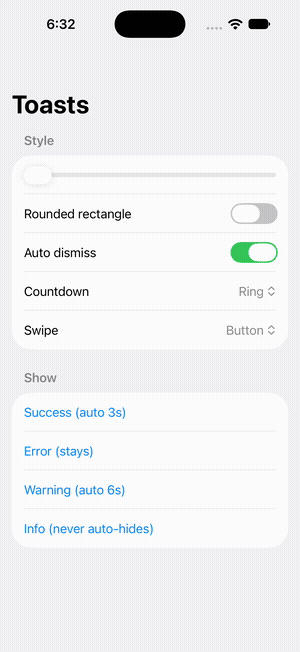
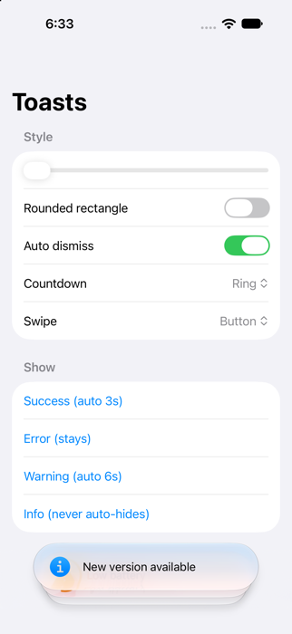
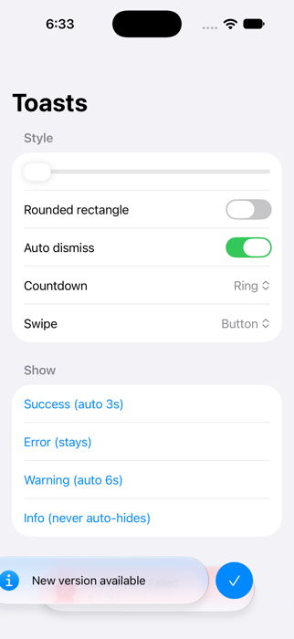
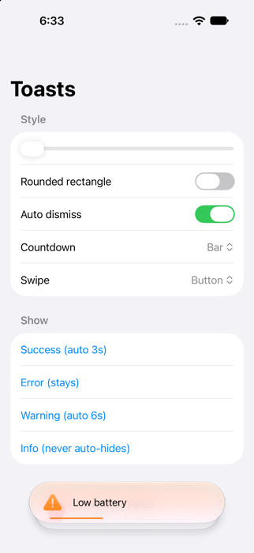

# StackedToasts

A SwiftUI stacked toast library for iOS. Toasts stack on top of each other, use Liquid Glass on iOS 26+, and can be restyled to match your app's theme: shape, fonts, colors, glass, shadow, animation, swipe behavior and auto-dismiss.

- Stacked layout built with `ScrollView` + `visualEffect` (no `ZStack` tricks)
- Swipe to dismiss, either with a button or directly
- Per-toast auto-dismiss with an animated countdown (ring or bar)
- One `ToastStyle` struct controls the whole look
- iOS 17+ with graceful fallbacks, Liquid Glass on iOS 26+

> Based on the tutorial by **Kavsoft**: [Stacked Toasts in SwiftUI](https://www.youtube.com/watch?v=4cLWzZ7_0Bk). All credit for the original idea and approach goes to Kavsoft.

## Preview

Recorded on iOS 27 (Liquid Glass).

<p align="center">
  
</p>

[Watch the full recording (mp4)](Docs/media/demo.mp4)

| Stacked toasts | Swipe to reveal button | Auto-dismiss countdown (bar) |
|:---:|:---:|:---:|
|  |  |  |

## Requirements

- iOS 17.0+
- Xcode 27+ to build

| OS | Background | Swipe button | Edge blur |
|---|---|---|---|
| iOS 27+ | Liquid Glass | native `swipeActions` | yes |
| iOS 26 | Liquid Glass | custom drag | yes |
| iOS 18 | blurred material | custom drag | no |
| iOS 17 | blurred material, linear tint gradient | custom drag | no |

## Installation

### Xcode

1. **File → Add Package Dependencies…**
2. Enter `https://github.com/Rk1821389/StackedToasts`
3. Set the dependency rule to **Up to Next Major Version** from `1.0.0`.
4. Add the **StackedToasts** product to your app target.

### Package.swift

```swift
dependencies: [
    .package(url: "https://github.com/Rk1821389/StackedToasts", from: "1.0.0")
],
targets: [
    .target(name: "MyApp", dependencies: ["StackedToasts"])
]
```

## Quick start

**1. Create a `ToastCenter` and attach it once at your root view.**

```swift
import SwiftUI
import StackedToasts

@main
struct MyApp: App {
    @State private var toasts = ToastCenter()

    var body: some Scene {
        WindowGroup {
            ContentView()
                .toastOverlay(toasts)
        }
    }
}
```

**2. Show a toast from anywhere.**

```swift
struct ContentView: View {
    @Environment(ToastCenter.self) private var toasts

    var body: some View {
        Button("Save") {
            toasts.show(.success("Saved", message: "Your changes are in"))
        }
    }
}
```

`toastOverlay(_:)` puts the `ToastCenter` into the environment, so any child view can read it with `@Environment(ToastCenter.self)`.

## Usage

### Presets

```swift
toasts.show(.success("Saved"))                                  // auto-hides after 3s
toasts.show(.error("Connection failed", message: "Try again"))  // stays until dismissed
toasts.show(.warning("Low battery", autoDismiss: 6))            // auto-hides after 6s
toasts.show(.info("Update available", autoDismiss: nil))        // stays
toasts.show(.success("Done", tint: .mint))                      // custom tint
```

### Custom toast

```swift
toasts.show(Toast(
    symbol: "star.fill",          // SF Symbol, optional
    title: "Starred",
    message: "Added to favorites", // optional
    tint: .purple,
    autoDismissInterval: 5         // seconds; nil = stays
))
```

### Dismissing

```swift
let id = toasts.show(.info("Uploading…", autoDismiss: nil))
toasts.dismiss(id: id)
toasts.dismissAll()
```

### Using your own array instead of `ToastCenter`

```swift
@State private var toasts: [Toast] = []

ContentView().toastOverlay($toasts)
```

### Placement

```swift
.toastOverlay(toasts, alignment: .bottom)   // default
```

## Customization

Everything lives in `ToastStyle`. Apply it near the root, or on a single screen, with `.toastStyle`:

```swift
var style = ToastStyle()
style.shape = .roundedRectangle(cornerRadius: 14)
style.titleFont = .system(.headline, design: .rounded)
style.titleColor = .white
style.usesGlass = false
style.solidBackground = .indigo
style.showsTintGradient = false
style.maxStackedBehind = 3

ContentView()
    .toastOverlay(toasts)
    .toastStyle(style)

// or tweak the current style in place:
ContentView().toastStyle { $0.glassTintOpacity = 0.4 }
```

| Group | Options |
|---|---|
| Layout | `height`, `maxWidth`, `horizontalPadding`, `contentSpacing`, `textSpacing`, `shape`, `bottomPadding` |
| Typography & color | `symbolFont`, `titleFont`, `messageFont`, `titleColor`, `messageColor`, `symbolColor`, `symbolUsesGradient`, `lineLimit`, `fontDesign`, `titleWeight`, `messageWeight`, `setFont(_:)` |
| Background | `usesGlass`, `glassTintOpacity`, `glassTintColor`, `solidBackground`, `showsTintGradient`, `topGradientOpacity`, `middleGradientOpacity` |
| Shadow | `shadowColor`, `shadowRadius`, `shadowOffset` |
| Stack | `maxStackedBehind`, `stackOffset`, `stackScaleStep`, `showsEdgeBlur` |
| Auto dismiss | `autoDismissEnabled`, `autoDismissIndicator` (`.ring` / `.bar` / `.none`), `indicatorColor`, `indicatorLineWidth` |
| Interaction | `swipeBehavior` (`.button` / `.direct` / `.disabled`), `swipeSymbol`, `swipeTint`, `allowsFullSwipe` |
| Animation | `animation`, `insertion`, `removal` |

### Shape

```swift
.toastStyle { $0.shape = .capsule }                           // default
.toastStyle { $0.shape = .roundedRectangle(cornerRadius: 12) }
.toastStyle { $0.shape = .custom(MyShape()) }                 // any Shape
```

### Fonts

```swift
.toastStyle { $0.titleFont = .system(size: 17, weight: .semibold) }
.toastStyle { $0.fontDesign = .rounded; $0.titleWeight = .bold }
.toastStyle { $0.setFont("Avenir Next") }   // custom font, scales with Dynamic Type
```

### Glass or solid background

```swift
.toastStyle { $0.glassTintOpacity = 0.3 }                      // stronger tint over glass
.toastStyle { $0.glassTintColor = .indigo }                    // custom glass tint
.toastStyle { $0.usesGlass = false; $0.solidBackground = .black }
```

On iOS before 26, glass falls back to a blurred material.

### Swipe: button or direct

```swift
.toastStyle { $0.swipeBehavior = .button }     // default: swipe reveals a button
.toastStyle { $0.swipeBehavior = .direct }     // swipe away to remove, no button
.toastStyle { $0.swipeBehavior = .disabled }
.toastStyle { $0.swipeSymbol = "xmark" }       // button icon
```

### Auto dismiss

The interval is set per toast (see presets above). While a toast waits, a countdown animates:

```swift
.toastStyle { $0.autoDismissIndicator = .ring }   // default, around the symbol
.toastStyle { $0.autoDismissIndicator = .bar }    // along the bottom edge
.toastStyle { $0.autoDismissIndicator = .none }   // no countdown, still animates out
.toastStyle { $0.autoDismissEnabled = false }     // no toast auto-hides anywhere
```

### Animation

```swift
.toastStyle {
    $0.animation = .spring(duration: 0.4, bounce: 0.2)
    $0.insertion = .move(edge: .bottom).combined(with: .opacity)
    $0.removal = .opacity
}
```

## Demo app

Open `Examples/SToasts.xcodeproj` and run. It lets you try presets, glass tint, shape, countdown style and swipe behavior.

## Credits

Kavsoft: [Stacked Toasts in SwiftUI (YouTube)](https://www.youtube.com/watch?v=4cLWzZ7_0Bk).
